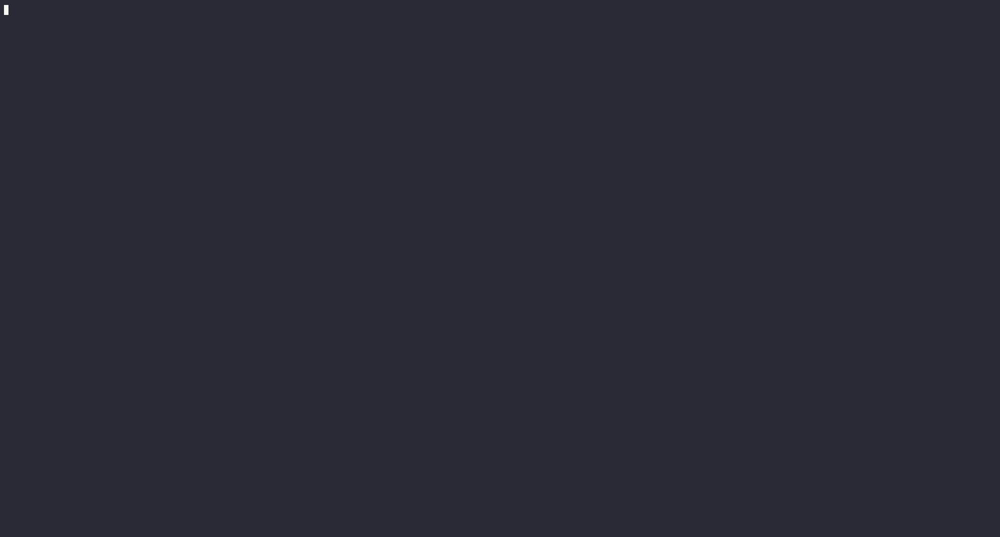

# grammar-tracker

Learn English while you work with Claude Code. grammar-tracker checks the English of every prompt you write, shows
your mistakes beside the chat as Claude answers, and counts the ones you keep repeating.

It is built for Spanish (well tested), Portuguese, French and Italian speakers: the check looks for the mistakes
speakers of your language make in English, such as "I have 30 years" for "I am 30 years old", or "actually" meant as
"currently".



[Watch it with pause and seek on asciinema.org](https://asciinema.org/a/evqqxrNYPzILjGzB).

## Features

- **A check of every prompt, with no extra step.** Claude starts each reply with a grammar check of your prompt. The
  mod hides it from the reply and shows it in a band above the prompt and in a side pane.
- **Mistakes explained.** Each mistake shows your sentence and the corrected sentence, with the changed words
  highlighted, the reason, and its type (verb tense, preposition, false friend and 15 more). The type's rule, with an
  example, is one key or click away.
- **The corrected prompt**, rewritten in natural English.
- **Recurring mistakes.** Every mistake has a counter across all your prompts. From the third time, the mod marks it
  as recurring.
- **Progress.** A streak of prompts in a row with no mistakes, across every conversation, next to your best streak,
  and a ranking of your top 10 mistakes with how often each came back in the last 7 days.
- **What to focus on.** The mistake type that fills most of your top 10, the mistake that rose most above your usual
  rate in the last 7 days, and a recurring mistake you did not make in the last 7 days, each with the rule to
  remember.
- **Dictation-aware.** Filler words, false starts and missing punctuation from voice input are not counted as
  mistakes.
- **Local and private.** Your history is stored in a SQLite file on your machine. The mod calls no service besides the
  Claude conversation you are already in.

<!-- GIF: the Top mistakes tab, opening a row -->

## How it works

The mod adds an instruction to each prompt that asks Claude to start its reply with a short JSON block. As soon as the
block closes, the mod saves it to SQLite and shows it, while Claude is still answering. The
[architecture document](docs/ARCHITECTURE.md) describes the modules, the database, the query command and how to
develop the mod.

## Requirements

- Claude Code in a terminal.
- Python 3.10 or newer on the `PATH` as `python3`, `py` or `python`, on Linux (well tested), macOS or Windows. Any install works
  (python.org, Microsoft Store, Homebrew, a Linux package). The mod needs no Python package.

## Install

At the Claude Code prompt:

```
/plugin install grammar-tracker --marketplace chaufon/qol
```

The [marketplace README](../../README.md) has the shell command, updates and uninstalling.

## Use

Write prompts as usual.

- **The band**, above the prompt, shows `⠋ Checking…` while Claude answers, then the result:
  `✗ 3 mistakes · ⟳ 1 recurring`, `✓ No mistakes`, or `Grammar check does not apply to the last prompt` (for a prompt
  too short to check or not in English).
- **The pane** opens by itself, without taking the focus, when a check finds mistakes. Open or close it with the
  band's `Show`/`Hide` button, or with `ctrl+x tab` then `g`. In the pane, `t` switches tabs, `r` shows or hides the
  type's rule on every card, `o` opens or closes every row of Top mistakes, and `h` or Esc hides the pane.
  - **Last prompt:** the mistakes, the recurring ones, your streak and your best streak; then one card per mistake,
    each with a `Show rule` button on its bottom border, and the corrected prompt. A prompt with no mistakes shows a
    line about your streak instead.
  - **Top mistakes:** your mistakes, your checked prompts, your recurring mistakes and the share of clean prompts,
    over all time; then your 10 most frequent mistakes, each with its count in the last 7 days; then **Focus next**.
    Click a row (`▸`) to see its latest example and its type's rule, and a Focus next item to see its rule.
- **Skip the check** for one prompt by starting it with `Claude, do not grammar check` (or `don't grammar check`,
  `skip grammar check`, `no grammar check`).

## Options

Change them with `/plugin configure grammar-tracker@qol` at the Claude Code prompt. `/plugin install` can also ask for
them when you install the mod.

| Option | Default | Effect |
| --- | --- | --- |
| `native_language` | `Spanish` | Your native language: `Spanish`, `Portuguese`, `French` or `Italian`. The check looks for the mistakes its speakers make |
| `autoOpenPane` | `true` | Open the pane by itself when a check finds mistakes. With `false`, the band still shows each check and `Show` opens the pane |
| `showTypeRules` | `false` | Show the type's rule, with an example, on every mistake card. `r` in the pane shows or hides them all for the rest of the conversation |

## Your data

The mod keeps your checks in `grammar.db`, and any errors in `errors.log`, in:

```
~/.claude/plugins/data/grammar-tracker-qol/
```

Updates keep the folder. Uninstalling deletes it, unless you uninstall with
`claude plugin uninstall grammar-tracker@qol --keep-data`.

## Limitations

- **The check costs tokens.** The instruction adds input tokens to every prompt, and the check adds output tokens to
  every reply.
- **Claude can be wrong.** The check is Claude's judgment of your English, and it can miss a mistake or report one
  that is not.
- **Terminal only.** The band and the pane are verified in the terminal. The Desktop app is not verified yet. The
  Claude mobile app (Remote Control) draws no mods and shows the full reply with the check. Claude Code on the web
  runs in the cloud, without the mod or your local database.
- **Four native languages.** Speakers of other languages can use the mod with the closest option, but the check will
  not look for the mistakes typical of their language.

## FAQ

**Does the mod send my prompts anywhere?**
No. The check happens inside the Claude conversation you are already in, and the results stay in a file on your
machine.

**Why does a reply start with "English grammar check" when I view the full reply (ctrl+o)?**
That is the check Claude wrote. The mod hides it on screen and reads it from there.

**A toast says `Grammar tracker needs Python 3.10 or newer`.**
The first Python on your `PATH` is older than 3.10. On macOS this is often the `python3` of Apple's Command Line Tools
(`/usr/bin/python3`): install a newer Python and start Claude Code from a terminal whose `PATH` finds it first.

**A toast says the mod cannot write to the data folder.**
The data folder is not writable, for example under a `CLAUDE_CONFIG_DIR` without write access. The prompts go on
without the check until the folder is writable.

**Something else went wrong.**
Look at `errors.log` in the data folder. Failures never block Claude Code: the prompt goes on without the check.
